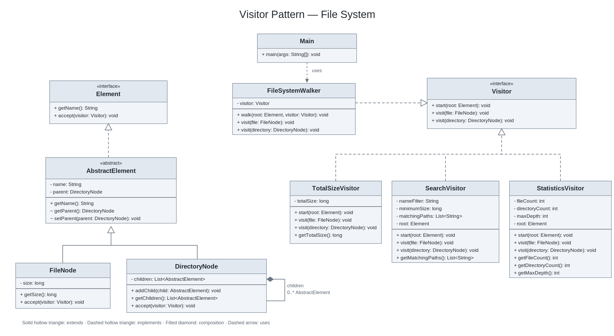

# SDP Assignment 6 - Visitor Pattern

## Description

This project implements an in-memory file system using the Visitor design pattern in Java.

The file system contains files and directories. Directories can contain files and other directories.

## Features

- Create files with names and sizes
- Create nested directories
- Calculate total file size
- Search files by name and minimum size
- Count files and directories
- Calculate maximum tree depth
- Prevent duplicate names, cycles and multiple parents

## Visitor Pattern

The project uses three visitors:

- TotalSizeVisitor - calculates the total size of files
- SearchVisitor - finds files matching search conditions
- StatisticsVisitor - collects file system statistics

FileNode and DirectoryNode implement the Element interface.

Each element uses accept() to call the correct visit() method.

## Traversal

FileSystemWalker controls the tree traversal.

It visits each element once and passes it to the selected visitor.

Visitors do not traverse child elements themselves.

Each visitor resets its results in start() before a new traversal, so the same visitor instance can be reused.

Search paths are relative to the selected root and sorted alphabetically.

The maximum depth is calculated from the root, which has depth 0.

## Extensibility

New operations can be added by creating another Visitor implementation without changing FileNode or DirectoryNode.

Adding a new element type requires updating the Visitor interface and its implementations.

## Requirements

- Java 17
- Maven

## Run Application

```bash
mvn compile exec:java
```

## Run Tests

```bash
mvn test
```

## Example Output

```text
Total size: 1570 bytes

Matching files:
documents/notes.txt
documents/projects/report.txt

Statistics:
Files: 4
Directories: 3
Maximum depth: 3
```

## Testing

JUnit 5 is used for automated testing.

Tests cover:

- Double dispatch
- Total file size
- Search filters
- Sorted relative paths
- File system statistics
- Empty directories
- Repeated visitor executions
- Tree integrity
- Encapsulation

## Technologies

- Java 17
- Maven
- JUnit 5

## UML Class Diagram



[UML Diagram SVG](docs/visitor_uml_diagram.svg)